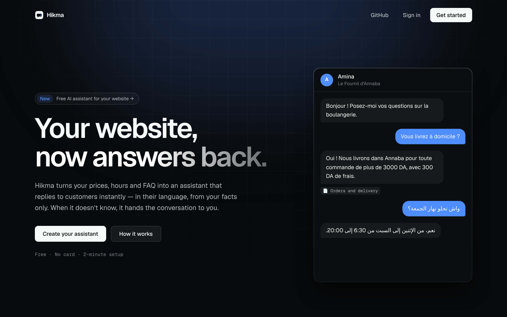
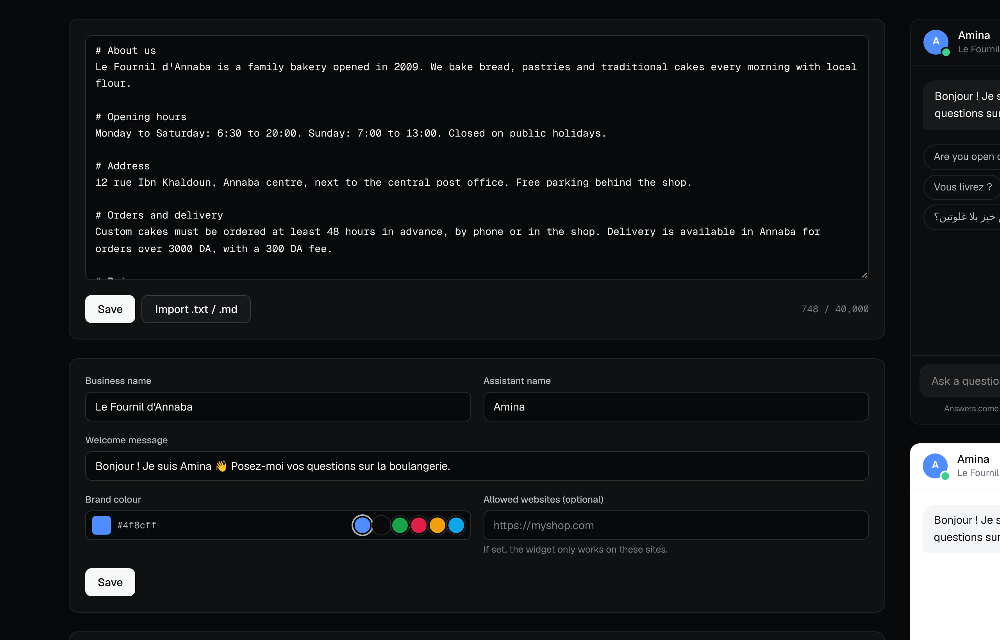

# Hikma

**An AI assistant that actually knows your business.**
Small businesses paste their information (prices, hours, delivery, FAQ), add one line of code to their website, and Hikma answers customers instantly — in their language, from the owner's facts only. When it doesn't know, it hands the conversation to a human.





## Features

| | |
|---|---|
| **Grounded answers with sources** | The knowledge base is split into numbered sections; every answer cites the sections it used, shown to the visitor as source chips. |
| **No made-up answers** | If the model can't cite a real section, the answer is marked *unanswered* — whatever the model claimed. |
| **Human handoff** | Unanswered questions offer an email form; leads land in the owner's inbox. |
| **Learns what's missing** | The dashboard lists questions the knowledge didn't cover, so the owner can fill the gaps. |
| **One-line widget** | `widget.js` adds a chat bubble to any site (WordPress, Shopify, Wix, HTML) through a sandboxed iframe. |
| **Multilingual** | Replies in the visitor's language — French, English, Arabic, Darija… |
| **Analytics** | Questions per month, % answered from the owner's info, open leads. |

## Security

- **Private knowledge base.** Visitors can never read it: column-level grants expose only an assistant's public face (name, colour, welcome); the server reads the knowledge with the service role.
- **Embedding locked per assistant.** Owners list their websites; `proxy.ts` sends `Content-Security-Policy: frame-ancestors` built from that list (validated origins only — no header injection). It fails closed.
- **Owner isolation with RLS** — owners can't read or edit each other's assistants, questions or leads, can't transfer ownership, and can't forge leads.
- **Prompt-injection aware.** Visitor messages are passed as data with explicit rules; output is a strict JSON schema, validated server-side (`src/lib/knowledge.ts`).
- **Abuse limits in Postgres** (`ai_allow`): per visitor per hour, per assistant per day, and global per day — keyed by a salted hash, no raw IPs stored. Keeps the Gemini free tier from being drained.
- **Widget** talks to the page only through a `postMessage` checked against the Hikma origin.

## Tests

```bash
npm test          # knowledge splitting, answer validation, origin validation (node:test)
npm run test:db   # 7 database security tests on a throwaway Postgres
npm run build
```

## Tech

Next.js 16 (App Router, Server Actions) · TypeScript · Tailwind CSS 4 · Geist · Supabase (Postgres, Auth, RLS) · Google Gemini (structured JSON output) · Zod · Vercel

## Run it yourself

1. **Supabase** — create a project, run `supabase/migrations/0001_init.sql` in the SQL Editor. Set Auth → URL Configuration (Site URL + `/auth/callback`).
2. **Gemini** — create a free API key in Google AI Studio.
3. **Env** — copy `.env.example` to `.env.local` (or set it in Vercel).
4. `npm install && npm run dev`

## Roadmap

Vector search (pgvector) for very large knowledge bases · PDF import · streaming replies · email notifications for new leads.

## License

MIT © [Kaerlix](https://kaerlix-maker.github.io)
